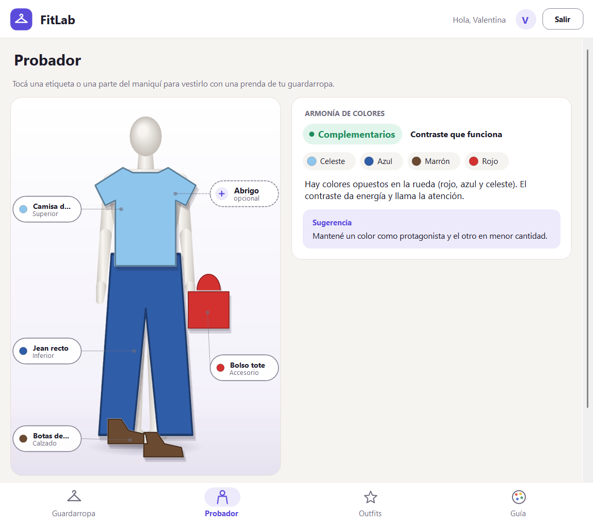
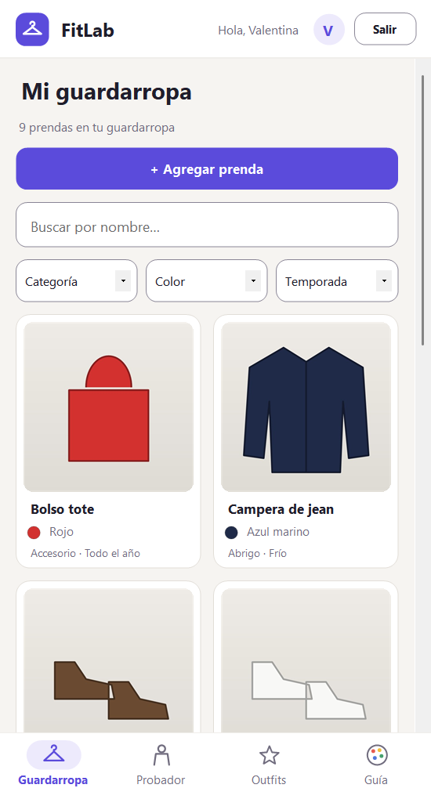
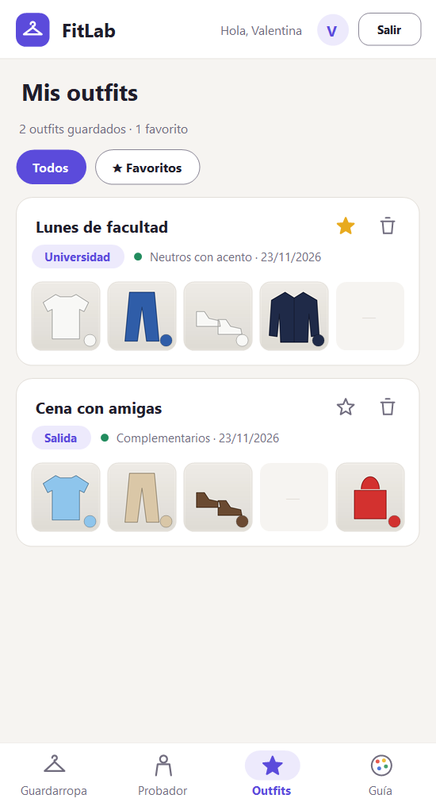
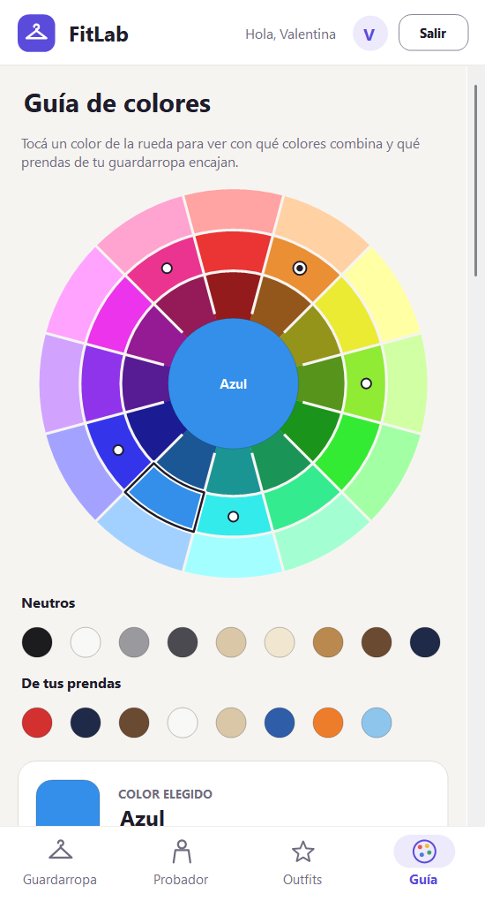
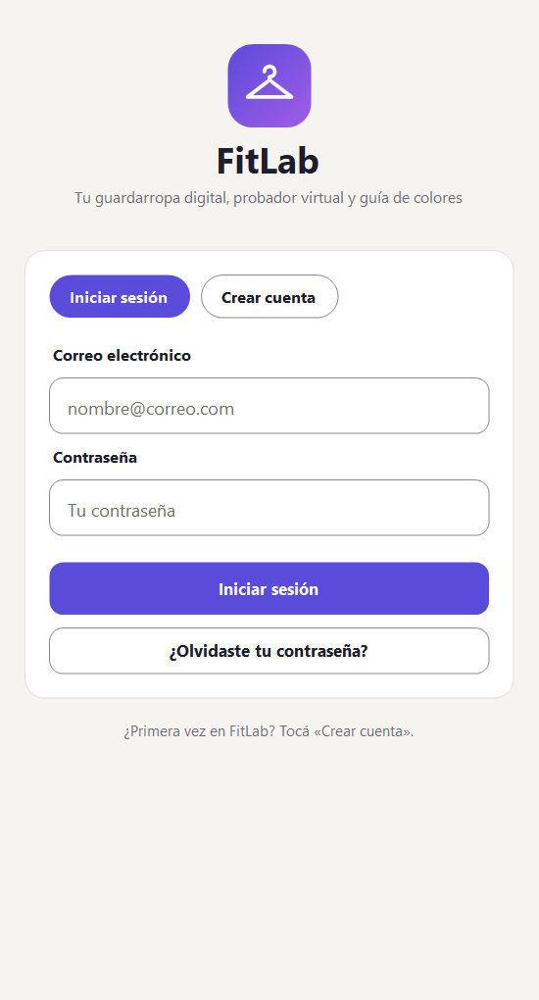

# FitLab

**Guardarropa digital, probador virtual y guía de colores.** Una app de escritorio para Windows, en español,
para fotografiar tu ropa, combinarla sobre un maniquí y saber si los colores combinan antes de vestirte.



## Qué puedes hacer

| | |
|---|---|
| **Guardarropa** | Sube tus prendas con foto (de la galería o la cámara), nombre, categoría, color, temporada y notas. Búscalas por nombre o fíltralas por categoría, color y temporada. |
| **Probador** | Viste el maniquí con tus prendas: a cada foto se le quita el fondo y la prenda se pone sobre el cuerpo, en capas. El botón *Aleatorio* arma una combinación que combine. |
| **Outfits** | Guarda las combinaciones con nombre y ocasión (casual, universidad, trabajo, salida, deporte), márcalas como favoritas y vuelve a probarlas. |
| **Guía de colores** | Elige un color en la rueda y mira con qué colores combina y qué prendas de tu guardarropa encajan. Al armar un outfit, la app explica si los colores combinan y sugiere cambios. |
| **Cuentas** | Cada persona tiene su cuenta y solo ve su ropa. Si olvidas la contraseña, la recuperas con un código. |

<table>
  <tr>
    <td></td>
    <td></td>
    <td></td>
    <td></td>
  </tr>
  <tr>
    <td align="center">Guardarropa</td>
    <td align="center">Outfits</td>
    <td align="center">Guía de colores</td>
    <td align="center">Inicio de sesión</td>
  </tr>
</table>

## Cómo empezar

Necesitas **Windows 10 u 11** y el **[SDK de .NET 10](https://dotnet.microsoft.com/download/dotnet/10.0)**.

```bash
git clone https://github.com/The-Engineer545/FitLab.git
cd FitLab
dotnet run --project frontend
```

La primera vez, crea tu cuenta con *Crear cuenta*. Al terminar, FitLab te muestra **una sola vez** un
código de recuperación: guárdalo, porque es la única forma de recuperar la contraseña si la olvidas.

### Fotos de las prendas
- Formatos: **JPG, PNG y WebP** (muchas fotos descargadas de tiendas son WebP aunque se llamen `.jpg`;
  FitLab las abre igual). HEIC (iPhone) y AVIF funcionan si Windows tiene instaladas sus extensiones.
- Tamaño máximo: **5 MB**. Las fotos se achican a 1000 px y se guardan como JPG.
- Para el probador, lo mejor son fotos de la prenda **sobre un fondo liso** (blanco o de un color parejo):
  así el fondo se quita bien. Si el fondo tiene objetos, la foto se muestra entera.

## Estructura del proyecto

```text
FitLab.slnx                 Solución con los tres proyectos
frontend/                   App de escritorio (Windows Forms): pantallas y controles dibujados a mano
  MainForm.cs               Ventana, navegación y estado de la sesión
  LoginView.cs              Inicio de sesión, registro y recuperación de contraseña
  WardrobeView.cs           Guardarropa
  GarmentEditorForm.cs      Formulario para subir o editar una prenda
  FitterView.cs             Probador y panel de armonía de colores
  FitterCanvas.cs           Maniquí que se viste con las prendas
  OutfitsView.cs            Outfits guardados
  GuideView.cs              Guía de colores y rueda de color
  Controls.cs, Dialogs.cs, Theme.cs   Controles, diálogos, colores y tipografía compartidos
backend/                    Datos y reglas, sin pantallas
  Database.cs               SQLite: cuentas, prendas, outfits y migraciones
  Photos.cs                 Importar, guardar y recortar fotos
  ColorTools.cs             Armonía de colores
  Models.cs                 Prenda, Outfit, Usuario y categorías
  DevSeed.cs                Cuenta de ejemplo (solo en compilaciones de depuración)
tests/                      Pruebas automáticas (xUnit) e imágenes de ejemplo
docs/                       Requisitos originales y capturas
```

## Comandos

| Para | Comando |
|---|---|
| Compilar todo | `dotnet build` |
| Abrir la app | `dotnet run --project frontend` |
| Correr las pruebas | `dotnet test` |
| Compilar para entregar | `dotnet publish frontend -c Release -r win-x64 --self-contained` |

Las pruebas cubren la armonía de colores, cuentas y recuperación de contraseña, migración de bases
viejas, prendas, outfits, importación de fotos (incluido WebP) y el recorte del fondo. Usan una carpeta
temporal y no tocan tus datos.

## Cómo funciona por dentro

**Tecnologías:** C# con .NET 10, Windows Forms con controles propios dibujados con GDI+, y SQLite
mediante `Microsoft.Data.Sqlite`. No usa servicios en internet.

- **Base de datos:** tablas `usuarios`, `prendas`, `outfits` y `outfit_prendas`. El esquema lleva número
  de versión (`PRAGMA user_version`) y los cambios se aplican solos en `Db.Migrate`, así que una base
  creada con una versión anterior se actualiza sin perder datos.
- **Contraseñas:** PBKDF2 con SHA-256 y 600.000 vueltas, con sal aleatoria. Las cuentas creadas con la
  protección anterior se actualizan al iniciar sesión.
- **Código de recuperación:** se genera al crear la cuenta (`XXXX-XXXX-XXXX`) y solo se guarda su hash.
  Sirve una sola vez: al usarlo, la app muestra uno nuevo.
- **Fotos:** se leen con GDI+ y, si no puede, con el lector de imágenes de Windows (WIC), que abre WebP.
  Se guardan como archivos, no dentro de la base de datos.
- **Probador:** `Photos.MakeCutout` quita el fondo partiendo desde los bordes de la foto y siguiendo el
  color del fondo, incluso con degradé. El maniquí se dibuja con degradés y sombras, y cada prenda se
  coloca en su zona del cuerpo. Es una vista 2D: el maniquí no gira.
- **Armonía de colores:** clasifica los colores (en HSV y CIELAB) en neutros, monocromáticos, análogos,
  complementarios o colores que compiten, y sugiere qué prenda cambiar.

## Dónde se guardan tus datos

En `%LOCALAPPDATA%\FitLab\`: `fitlab.db` (la base de datos) y `fotos\` (las imágenes). La variable de
entorno `FITLAB_DATA` permite usar otra carpeta.

Los datos quedan **solo en tu computadora** y no están cifrados: las cuentas separan los guardarropas
dentro de la app, pero quien use tu misma sesión de Windows puede abrir esos archivos.

## Accesibilidad y teclado

Todo se puede usar con el teclado, y los controles tienen nombres para lectores de pantalla.

- **Tab** recorre botones, tarjetas y campos; **Enter** o **Espacio** los activan; **Esc** cierra los diálogos.
- Barra inferior: **flechas izquierda/derecha** cambian de pantalla.
- Maniquí: **flechas** para moverse entre las prendas, **Enter** para elegir una, **Suprimir** para quitarla.
- Rueda de color: **izquierda/derecha** cambian el tono; **arriba/abajo**, la intensidad.
- Tarjeta de outfit: **Enter** lo abre, **F** lo marca como favorito, **Suprimir** lo elimina.

## Para desarrollo

Las compilaciones de depuración (Debug) pueden sacar capturas automáticas con una cuenta de ejemplo;
así se generaron las de `docs/capturas`. Por ejemplo, para el probador en una ventana ancha:

```bash
set FITLAB_DATA=%TEMP%\fitlab-demo
set FITLAB_DEMO=1
set FITLAB_TAB=1
set FITLAB_W=1150
frontend\bin\Debug\net10.0-windows\FitLab.exe --screenshot docs\capturas\probador.png
```

`FITLAB_TAB` elige la pantalla (0 guardarropa, 1 probador, 2 outfits, 3 guía; 4 a 8 abren diálogos) y
`FITLAB_W` el ancho de la ventana. Nada de esto existe en la versión Release.

Los requisitos originales y en qué se diferencia la app de ellos están en [docs/requisitos.md](docs/requisitos.md).
